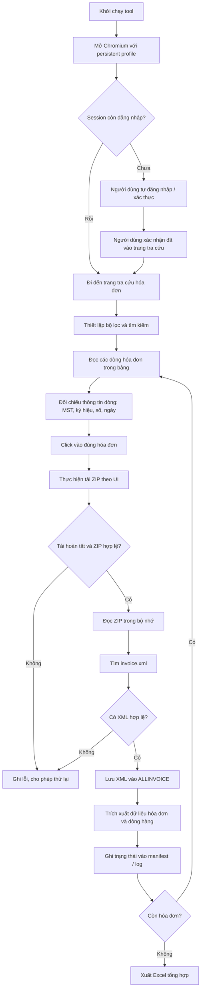

# Đặc tả dự án: Tool tự động tải XML hóa đơn từ cổng Thuế

## 1. Mục tiêu

Xây dựng ứng dụng desktop chạy trên Windows để:

1. Mở trình duyệt Chromium bằng Playwright với **persistent session**.
2. Người dùng tự đăng nhập cổng Thuế trong cửa sổ trình duyệt được mở.
3. Sau khi đăng nhập thành công, tool hỗ trợ tra cứu hóa đơn mua vào theo bộ lọc người dùng chọn.
4. Tool duyệt từng hóa đơn trong bảng kết quả. Theo luồng hiện tại, cần **click vào hóa đơn trước**, sau đó mới thực hiện thao tác tải.
5. Mỗi lần tải có thể nhận được một file ZIP. Tool chỉ lấy file `invoice.xml` bên trong ZIP, bỏ qua `details.js`, `invoice.html` và các ảnh.
6. Lưu tất cả XML đã trích xuất vào thư mục `ALLINVOICE`.
7. Tạo file Excel tổng hợp thông tin hóa đơn và chi tiết hàng hóa để phục vụ bước đối chiếu với iPOS.

> Phạm vi tài liệu này tập trung vào tải và chuẩn hóa dữ liệu từ cổng Thuế. Phần đối chiếu iPOS sẽ là module riêng ở giai đoạn tiếp theo.

## 2. Nguyên tắc quan trọng

- **Không lưu mật khẩu** cổng Thuế trong mã nguồn, file cấu hình hoặc log.
- Dùng persistent browser profile để giữ session/cookie giữa các lần chạy. Session có thể hết hạn; khi đó dừng và yêu cầu người dùng đăng nhập lại.
- Người dùng tự hoàn thành CAPTCHA, MFA hoặc bước xác minh được yêu cầu. Không tìm cách vượt qua cơ chế bảo vệ.
- Không giả định URL tải XML hoặc API nội bộ. Trước khi triển khai, xác nhận luồng thao tác trên cổng Thuế thật.
- Tải tuần tự hoặc giới hạn tốc độ; không gửi nhiều yêu cầu đồng thời gây tải cho cổng.
- Không coi việc click hàng là đủ: phải xác nhận đúng hóa đơn bằng MST người bán, ký hiệu, số hóa đơn và ngày lập trước khi tải.
- Không ghi đè XML đã tồn tại nếu chưa xác minh đó là cùng một hóa đơn. Dùng khóa định danh hóa đơn và hậu tố an toàn khi có trùng tên.
- XML là dữ liệu nguồn; Excel là báo cáo dẫn xuất. Giữ XML gốc để kiểm tra lại.
- File HTML đã cung cấp cho thấy bảng dùng Ant Design với các dòng `tr.ant-table-row` và thuộc tính `data-row-key`. Đây là manh mối ban đầu, không phải cam kết selector sẽ ổn định trên website thật. Nên ưu tiên locator theo vai trò/nội dung hiển thị và kiểm thử selector sau mỗi thay đổi giao diện.

## 3. Luồng xử lý tổng thể



## 4. Cấu trúc thư mục dự kiến

```text
TaxInvoiceDownloader_Project/
├── README.md
├── requirements.txt
├── .gitignore
├── ALLINVOICE/                     # Chỉ chứa XML hóa đơn đã trích xuất
├── downloads/                      # ZIP tạm tải từ cổng Thuế
├── logs/                           # Log, lỗi và lịch sử chạy
├── browser_profile/                # Persistent session của Playwright (tạo khi chạy)
├── output/
│   └── tax_invoices.xlsx           # Excel được tạo sau khi chạy
├── src/
│   └── tax_invoice_downloader/
│       ├── __init__.py
│       ├── app.py                  # Điểm chạy ứng dụng / giao diện
│       ├── browser_session.py      # Persistent context và kiểm tra session
│       ├── tax_portal.py           # Tra cứu, duyệt bảng, click hóa đơn, tải
│       ├── download_manager.py     # Chờ download, kiểm tra ZIP
│       ├── zip_xml_extractor.py    # Chỉ lấy invoice.xml từ ZIP
│       ├── xml_parser.py           # Đọc XML và chuẩn hóa dữ liệu
│       ├── excel_exporter.py       # Xuất workbook nhiều sheet
│       ├── models.py               # Cấu trúc dữ liệu
│       └── logging_config.py       # Log
├── tests/
│   ├── test_zip_xml_extractor.py
│   └── test_xml_parser.py
└── docs/
    └── SPEC.md                     # Tài liệu đặc tả này
```

### Ý nghĩa các thư mục

- `ALLINVOICE/`: nơi lưu **chỉ các file `.xml`** đã trích xuất. Không lưu ZIP, HTML, JS hay ảnh ở đây.
- `downloads/`: nơi Playwright tải ZIP tạm thời; có thể xóa ZIP sau khi XML được kiểm tra và lưu thành công, tùy chính sách vận hành.
- `browser_profile/`: hồ sơ trình duyệt để duy trì session. Đây là dữ liệu nhạy cảm; không chia sẻ, không đưa vào Git và không tự động xóa khi ứng dụng khởi động.
- `logs/`: trạng thái mỗi hóa đơn như `PENDING`, `DOWNLOADED`, `XML_EXTRACTED`, `EXPORTED`, `FAILED`.
- `output/`: báo cáo Excel và các tệp đầu ra khác.

## 5. Quy tắc đặt tên XML

Tên file ZIP tải về có thể giống nhau hoặc có hậu tố như `(1)`, do đó không dùng tên ZIP làm định danh duy nhất.

Sau khi đọc XML, tạo tên theo mẫu:

```text
{MST_NGUOI_BAN}_{KY_HIEU}_{SO_HOA_DON}_{NGAY_LAP}.xml
```

Ví dụ:

```text
3400401523_C26TNT_00005286_20261009.xml
```

Quy tắc:

- Giữ số hóa đơn dưới dạng chuỗi để không mất số 0 ở đầu.
- Loại bỏ ký tự không hợp lệ trong tên file.
- Nếu file đích đã tồn tại, kiểm tra khóa định danh và nội dung. Nếu cùng hóa đơn, đánh dấu đã xử lý; nếu khác, lưu tên thay thế và ghi cảnh báo.
- Không đưa thông tin cá nhân không cần thiết vào tên file.

## 6. Cách quản lý session

1. Lần đầu chạy, mở Chromium bằng `launch_persistent_context(user_data_dir="browser_profile")`.
2. Tool điều hướng đến cổng Thuế.
3. Người dùng tự đăng nhập và hoàn thành xác thực.
4. Người dùng bấm nút “Đã đăng nhập, tiếp tục” trong tool hoặc xác nhận qua giao diện.
5. Các lần chạy tiếp theo dùng lại profile đó để tận dụng session còn hiệu lực.
6. Nếu cổng Thuế chuyển về trang đăng nhập, báo “Session hết hạn”, dừng tải và chờ người dùng đăng nhập lại.
7. Không cố tự động xử lý CAPTCHA/MFA, không trích xuất hoặc gửi cookie sang nơi khác.

Lưu ý: persistent profile giúp giữ phiên khi website cho phép, nhưng **không đảm bảo đăng nhập vĩnh viễn**. Website có thể yêu cầu xác thực lại.

## 7. Quy tắc tương tác với bảng hóa đơn

File HTML mẫu cung cấp cho thấy bảng có các cột như:

- STT
- Mã số thuế người mua
- Ký hiệu mẫu số
- Ký hiệu hóa đơn
- Số hóa đơn
- Ngày lập
- Thông tin người bán
- Tổng tiền chưa thuế
- Tổng tiền thuế
- Tổng tiền chiết khấu thương mại
- Tổng tiền phí
- Tổng tiền thanh toán
- Đơn vị tiền tệ
- Trạng thái hóa đơn
- Kết quả xử lý / kiểm tra
- Hóa đơn liên quan

Dòng mẫu có `data-row-key` chứa các phần như mã định danh, MST người bán, ký hiệu và số hóa đơn. Chỉ dùng `data-row-key` như phương án hỗ trợ sau khi kiểm chứng trên trang thật.

### Quy trình cho mỗi hóa đơn

1. Đọc thông tin dòng hiện tại và tạo khóa ứng viên.
2. Xác nhận dòng thuộc phạm vi tra cứu.
3. Click đúng dòng/hóa đơn theo thao tác người dùng thực hiện trên trang.
4. Chờ trang chi tiết hoặc vùng chi tiết hiện ra.
5. Kiểm tra lại số hóa đơn/ký hiệu/MST để chắc chắn đã mở đúng hóa đơn.
6. Kích hoạt nút tải XML theo giao diện thật.
7. Chờ sự kiện download hoàn tất; không chỉ chờ một khoảng thời gian cố định.
8. Kiểm tra tệp tải có tồn tại, kích thước hợp lệ và mở được như ZIP.
9. Trích `invoice.xml`, xác thực XML parse được, sau đó lưu vào `ALLINVOICE/`.
10. Ghi kết quả vào manifest và chuyển sang hóa đơn tiếp theo.

### Phân trang

- Đọc số lượng kết quả và các dòng của trang hiện tại.
- Sau khi xử lý xong, bấm “Trang tiếp” nếu còn trang.
- Không dựa vào STT làm khóa duy nhất vì STT có thể bắt đầu lại ở mỗi trang.
- Lưu tiến độ để khi dừng giữa chừng có thể tiếp tục, tránh tải lại hóa đơn đã hoàn thành.

## 8. Trích `invoice.xml` từ ZIP

Mỗi ZIP ví dụ có thể chứa:

```text
details.js
invoice.html
invoice.xml
sign-check.jpg
viewinvoice-bg.jpg
```

Chỉ lấy `invoice.xml`; bỏ qua các tệp còn lại. Nên đọc ZIP trực tiếp trong bộ nhớ bằng `zipfile`, không cần giải nén toàn bộ nội dung.

Điều kiện an toàn:

- Chỉ đọc member có tên kết thúc bằng `invoice.xml` (không phân biệt chữ hoa/thường).
- Nếu không có hoặc có nhiều ứng viên, ghi lỗi để xử lý, không tự chọn bừa.
- Không dùng đường dẫn bên trong ZIP làm đường dẫn ghi file.
- Giới hạn kích thước giải nén để phòng ZIP bất thường.
- Parse XML và xác minh có thông tin hóa đơn cơ bản trước khi lưu.
- Không xóa ZIP cho đến khi XML được lưu và xác minh thành công.

## 9. Thiết kế file Excel

Tạo `output/tax_invoices.xlsx` với các sheet:

### `HoaDon`

Một dòng cho mỗi hóa đơn:

- Mã số thuế người bán
- Tên người bán
- Mã số thuế người mua
- Ký hiệu mẫu số
- Ký hiệu hóa đơn
- Số hóa đơn
- Ngày lập
- Tiền trước thuế
- Tiền thuế
- Chiết khấu
- Tiền phí
- Tổng thanh toán
- Loại tiền
- Trạng thái / thông tin điều chỉnh-thay thế nếu có
- Tên file XML
- Trạng thái trích xuất

### `ChiTietSanPham`

Một dòng cho mỗi mặt hàng trong hóa đơn:

- Khóa hóa đơn
- MST người bán
- Ký hiệu hóa đơn
- Số hóa đơn
- Ngày lập
- Mã hàng
- Tên hàng
- Đơn vị tính
- Số lượng
- Đơn giá
- Thành tiền
- Thuế suất
- Tiền thuế dòng hàng nếu XML có
- Tên file XML nguồn

### `LichSuTai`

- Thời điểm chạy
- Khóa hóa đơn
- Trạng thái
- Số lần thử
- Tên ZIP tạm
- Tên XML đầu ra
- Thông báo lỗi

### `ThongKe`

- Số dòng hóa đơn tìm thấy
- Số hóa đơn đã tải
- Số XML trích xuất thành công
- Số hóa đơn lỗi
- Số hóa đơn bị bỏ qua do đã tồn tại

Không suy đoán giá trị bị thiếu. Nếu XML không có trường, để trống và ghi nhận phù hợp.

## 10. Quy tắc đọc XML

- XML có thể khác namespace hoặc cấu trúc giữa các phiên bản; parser phải xử lý namespace và kiểm tra trường bắt buộc.
- Giữ số hóa đơn, MST và mã hàng dưới dạng chuỗi.
- Chuyển số tiền/số lượng thành kiểu số bằng hàm chuẩn hóa có kiểm soát; không loại bỏ nhầm dấu thập phân.
- Phân biệt tiền trước thuế, thuế và tổng thanh toán.
- Hóa đơn điều chỉnh/thay thế cần giữ thông tin quan hệ; không coi tất cả là hóa đơn độc lập để cộng tổng một cách máy móc.
- Ghi lại XML nguồn để có thể truy vết từ mỗi dòng Excel.

## 11. Lỗi và khả năng tiếp tục

Các lỗi phải được xử lý riêng từng hóa đơn:

- Session hết hạn.
- Không tìm thấy dòng hóa đơn.
- Click không mở đúng chi tiết.
- Không tìm thấy nút tải.
- Download timeout.
- ZIP hỏng hoặc không phải ZIP.
- Không tìm thấy `invoice.xml`.
- XML sai định dạng hoặc thiếu trường.
- Không ghi được file do quyền truy cập hoặc file đang bị khóa.
- Excel không thể xuất.

Mỗi lỗi phải được ghi log, không làm dừng toàn bộ hàng trăm hóa đơn. Có thể thử lại một số lỗi tạm thời với số lần giới hạn. Lỗi xác thực cần dừng để người dùng xử lý.

## 12. Tiêu chí hoàn thành (Acceptance Criteria)

- Người dùng đăng nhập thủ công ở lần đầu; session được tái sử dụng khi còn hợp lệ.
- Tool duyệt đúng từng hóa đơn, click mở chi tiết trước khi tải.
- Tool không nhầm hóa đơn có số gần giống nhau hoặc số 0 đầu.
- Với mỗi ZIP hợp lệ, chỉ `invoice.xml` được lưu vào `ALLINVOICE/`.
- Không lưu `details.js`, `invoice.html` hay ảnh vào `ALLINVOICE/`.
- XML đã tồn tại được nhận diện để tránh xử lý trùng.
- Một hóa đơn lỗi không làm hỏng cả lượt chạy.
- Có thể tiếp tục từ trạng thái đã lưu.
- Excel có các sheet hóa đơn, chi tiết sản phẩm, lịch sử tải và thống kê.
- Các con số trong Excel có thể truy ngược về file XML nguồn.

## 13. Công nghệ khuyến nghị

- Python 3.12+
- Playwright Python
- `lxml` hoặc `xml.etree.ElementTree`
- `openpyxl` hoặc `pandas`
- SQLite để lưu tiến độ và tránh tải trùng
- Tkinter hoặc PySide6 cho giao diện desktop ở giai đoạn triển khai

## 14. Thứ tự triển khai

1. Kiểm tra thủ công luồng: mở hóa đơn → tải ZIP → xác định nút và hành vi thực tế.
2. Làm `zip_xml_extractor.py` với ZIP mẫu.
3. Làm `xml_parser.py` và kiểm tra dữ liệu XML.
4. Làm xuất Excel từ một số XML mẫu.
5. Làm persistent session và bước xác nhận đăng nhập thủ công.
6. Tự động xử lý một hóa đơn mẫu.
7. Mở rộng sang phân trang và nhiều hóa đơn.
8. Bổ sung SQLite, retry, resume và log.
9. Chạy kiểm thử với một tập nhỏ trước khi chạy hàng trăm hóa đơn.

## 15. Lưu ý về phạm vi và quyền truy cập

Tool chỉ thao tác dữ liệu mà tài khoản người dùng được phép truy cập. Không cố vượt CAPTCHA/MFA, không giả mạo phiên, không gọi endpoint không được phép. Trước khi triển khai selector và thao tác tải, cần kiểm thử trên cổng Thuế thật vì file HTML lưu lại không nhất thiết phản ánh toàn bộ trạng thái động của website.
